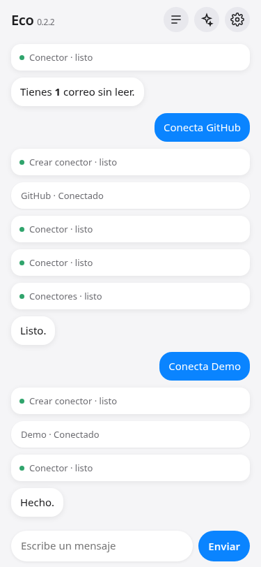

# Eco

Agente de IA que corre en tu navegador, sin servidor. Conversa con un modelo de OpenRouter, usa herramientas y crea sus propios conectores a APIs externas.



## Uso

1. Abre la app en GitHub Pages.
2. En **Ajustes** pon tu clave de OpenRouter y, si quieres, el modelo (por defecto `openrouter/auto`).
3. Pide lo que necesites, por ejemplo «Conéctate a mi Gmail». Eco propone el conector, tú lo apruebas y la app te muestra un formulario seguro para iniciar sesión.

## Conectores

- Se crean con la herramienta `create_connector`: URL base, tipo de acceso y operaciones HTTP. Crear un conector y toda operación de escritura piden tu aprobación.
- Acceso: token, clave de API (cabecera o query), usuario y contraseña, u OAuth 2 (código con PKCE o token implícito) con tu propio Client ID.
- Las credenciales se cifran con AES-GCM usando una clave no exportable guardada en IndexedDB y solo se descifran al hacer la petición. El modelo nunca las ve: solo sabe si el conector está conectado.
- En **Ajustes › Conectores** puedes conectar, quitar el acceso o eliminar cada conector.

### OAuth (por ejemplo Gmail)

Crea un Client ID OAuth tipo «Aplicación web» en la consola del servicio (en Google: Google Cloud Console, con la API de Gmail habilitada) y autoriza:

- Origen JavaScript: el origen de tu Pages, `https://<usuario>.github.io`
- URL de redirección: `https://<usuario>.github.io/eco/oauth.html`

Eco nunca trae un Client ID propio: cada persona usa el suyo. La tarjeta de inicio de sesión incluye una guía paso a paso y botones para copiar el origen y la URL de redirección exactos. Pega el Client ID cuando Eco te lo pida.

### Renovación automática

Al crear un conector OAuth, Eco elige cómo renovar el acceso: con refresh token si el servicio lo entrega o, como en Google, con una renovación silenciosa (`prompt=none`). Mientras la página esté abierta, una tarea programada renueva cada acceso unos minutos antes de que expire, sin pedirte nada. Si el navegador o el servicio no lo permiten, el conector queda como «Expirado» y Eco te pide iniciar sesión la próxima vez que lo uses.

## Herramientas

`create_connector`, `list_connectors`, `call_connector`, `request_sign_in`, `memory`, `todo_list`, `skills_list`, `skill_view`, `skill_manage`, `session_search`, `clarify` y `delegate_task` (encarga una tarea a un subagente con contexto limpio).

El historial largo se resume automáticamente. Las respuestas se muestran con formato Markdown seguro.

## Privacidad

Todo se guarda solo en tu navegador (localStorage e IndexedDB). Las llamadas van directo del navegador a OpenRouter y a los servicios que conectes.

## Local

```sh
python3 -m http.server
```

## Licencia

MIT. Basada en Hermes Agent de Nous Research (MIT). Usa Pyodide (MPL-2.0) desde CDN. Ver [LICENSE](LICENSE).
